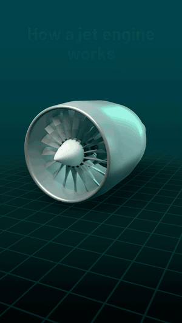

# 3d-shorts-skill

A [Claude Code](https://claude.com/claude-code) skill that turns one sentence into a finished vertical 3D explainer Short.

> "Make a 3D short about how a jet engine works."

Claude builds a stylized 3D object in Blender, opens it up (cutaway, X-ray or exploded view), animates glowing flow lines,
writes the narration, records a free local voice, adds captions, labels and a mixed soundtrack, and hands you a
**1080x1920, 30 fps MP4 of about 40 seconds** - ready for YouTube Shorts, TikTok or Reels.

Everything runs on your own computer. No account, no API key, no cloud render.

**This is the format behind 190M+ view Shorts.** Zack D. Films' top 3D "how it works" Shorts have 255M and 217M views (23 of its Shorts are above 100M) - [see the numbers](#why-this-format). This skill builds Shorts of that kind with Claude.

> **Like it? Please star the repo** ⭐ - it is the best way to say thanks, and it tells me to keep going.
> This project is actively maintained: new objects, reveals, looks and voices are coming. Star it (or Watch → Releases) to follow along.

## See what it makes

This is the demo Short (`projects/demo-jet-engine`), made from the prompt above - 37 seconds, 1080x1920, voice, captions and music included.

<p align="center">
  <a href="docs/demo/jet-engine.mp4"></a>
</p>

**[Watch the full Short with sound (jet-engine.mp4)](docs/demo/jet-engine.mp4)** - click, then press play. The voice is the free local Piper voice.

## Why this format

Short 3D "how does it work" videos are some of the most-watched content on YouTube. Zack D. Films ([@zackdfilms](https://www.youtube.com/@zackdfilms), 29.6M subscribers) has made thousands of them:
the median of its 4,148 Shorts is about **14 million views** (our count, November 2026), 23 are above 100M, two are above 190M, and the best ones are:

| Short | Views |
|---|---|
| [How Stitches Work](https://www.youtube.com/shorts/ttuKeS5k4Uo) | 255M |
| [How Splinters Get Unstuck](https://www.youtube.com/shorts/yGw0nhlUtkQ) | 217M |
| [How Long Are Your Blood Vessels?](https://www.youtube.com/shorts/c5G_25dhoeU) | 158M |

The pattern: one curiosity question, 25-40 seconds, a clear 3D view of the mechanism, narrated. This skill builds that kind of Short for you with Claude.
It uses its own look (a studio-lit object with cutaways and flow lines), not a copy of anyone's videos, and views are never guaranteed - the idea and the hook decide.
(Third-party videos are linked, not included. View counts change.)

## What you need

- A computer with about 3 GB free disk space (macOS, Linux or Windows) and a graphics driver that supports OpenGL 4.3 / Metal (needed by Blender's EEVEE renderer; no dedicated GPU required). An Apple-silicon Mac (M4) renders a final Short in about 40 minutes.
- [Claude Code](https://claude.com/claude-code).
- That is all: the skill installs Blender, ffmpeg, Python packages and a free voice for you, after asking.

## Use it

```bash
git clone https://github.com/RishiGitH/3d-shorts-claude-skill.git
cd 3d-shorts-claude-skill
claude
```

Then type, for example:

- `Make a 3D short about how a jet engine works.`
- `Make a 3D short about what's inside a lithium battery.`

Claude checks the machine (`python engine/setup/doctor.py`), asks once before installing anything, drafts a quick 540x960 preview
(about 2 minutes), checks it, then renders the final. Output lands in `out/<slug>/short.mp4`.

More ideas: `.claude/skills/3d-short/examples/prompts.md`.

## How it works

```
prompt -> brief + script (100-140 words)
       -> hero object (Blender, procedural or a free .glb)
       -> shots.json (camera, reveal, flow lines, labels per shot)
       -> voice (Piper, local)  -> timing
       -> Blender render per shot (EEVEE)  -> mix (voice + bed + sfx, -14 LUFS)
       -> overlay (captions, labels, badge, title via Pillow) -> ffmpeg -> short.mp4
```

| Folder | What |
|---|---|
| `.claude/skills/3d-short/` | the skill: SKILL.md (entry), WORKFLOW, SCRIPT, LOOK, QA, TROUBLESHOOTING, examples |
| `engine/` | the pipeline: `make_short.py` (one command), `blender/` (studio, shots, props), `voice/`, `audio/`, `overlay/`, `setup/` |
| `projects/demo-jet-engine/` | a complete working example (script, shots, brief) |
| `assets/` | fonts, licences, the downloaded voice model |

## Run it by hand

```bash
bash engine/setup/install.sh                 # once (Windows: engine\setup\install.ps1)
python engine/setup/doctor.py                # everything OK?
.venv/bin/python engine/make_short.py projects/demo-jet-engine --draft   # 2-minute preview
.venv/bin/python engine/make_short.py projects/demo-jet-engine           # final
```

## The look

"Studio Glow": a dark teal studio, a silver object with coral cut faces, and colour-coded glowing flow lines
(mint air, orange heat, yellow fuel, violet electricity). See `.claude/skills/3d-short/LOOK.md`.

## Voices

Default: free Piper `en_US-libritts_r-medium` (CC BY 4.0). Optional nicer voices with your own key:
`--voice gemini` (`GEMINI_API_KEY`) or `--voice elevenlabs` (`ELEVENLABS_API_KEY`, `ELEVENLABS_VOICE_ID`). These send the narration text to that provider.

## Limits

- Tested with Blender 5.2 on macOS. Blender 4.2-5.1 and Linux/Windows installers are written but less tested.
- Best for mechanical "how does X work" objects with a front-to-back sequence. Not for people, animals or software.
- The narration facts are written by an AI: check every number before you publish.

## Licence

Code: MIT. Fonts and voice have their own licences - see `assets/LICENSES.md`.
